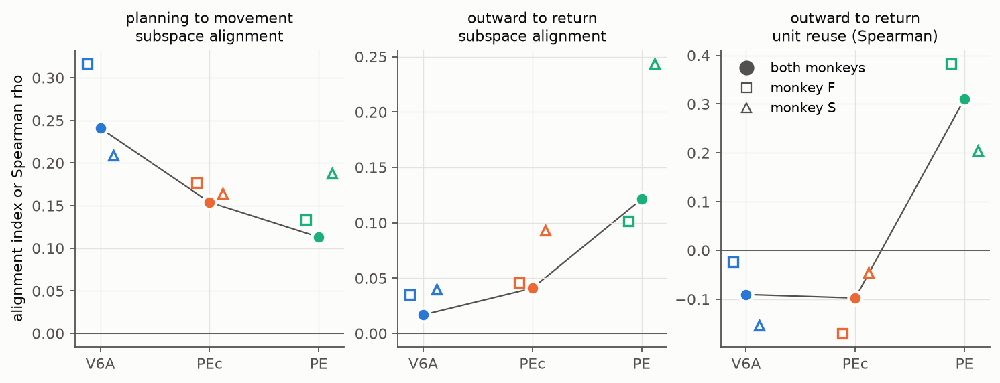
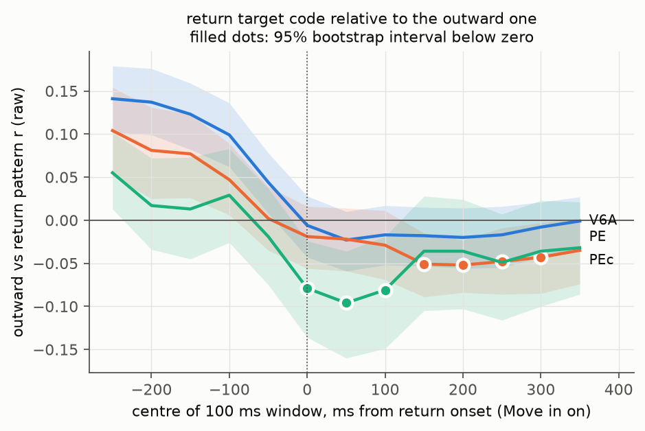
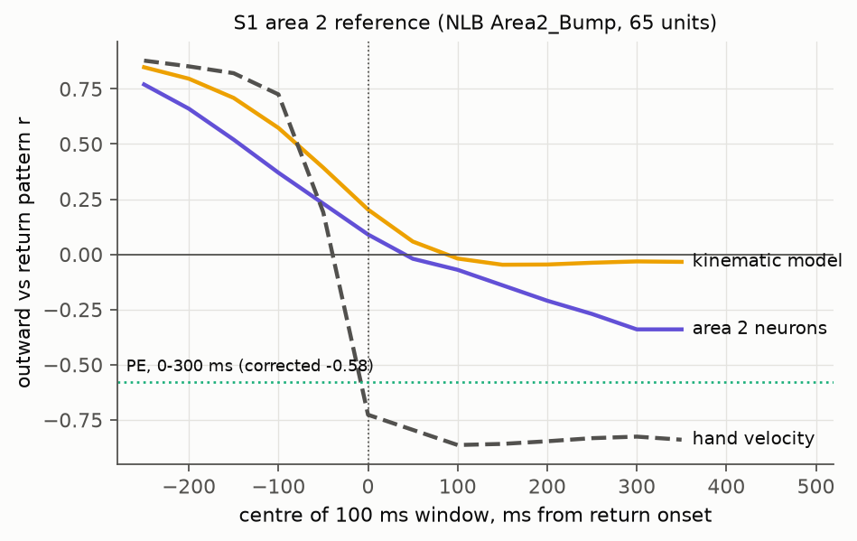
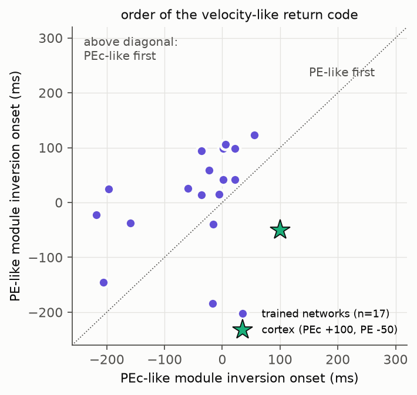
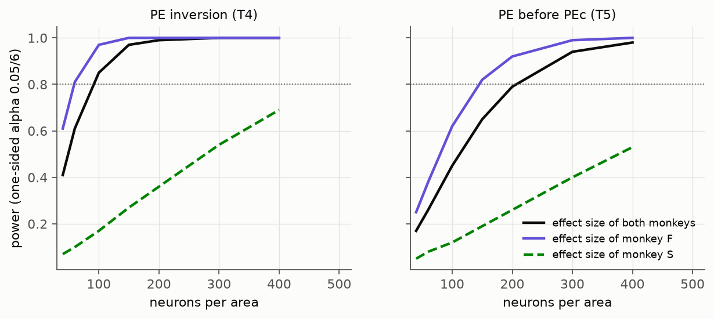

# the return reach in the macaque superior parietal lobule

a reanalysis of the Fattori lab's public recordings from three parietal areas
it asks how each area handles the second half of a reach, when the hand travels back to where it started
written 25 November 2026

the data is Diomedi et al. 2024 (*Scientific Data* 11, 624), shared on G-Node GIN under CC-BY 4.0
every number below comes from the scripts in `code/`, and every figure from `code/figures.py`

## contents

1. [the data and the task](#1-the-data-and-the-task)
2. [the hypothesis being tested](#2-the-hypothesis-being-tested)
3. [the measures](#3-the-measures)
4. [what was run and what came out](#4-what-was-run-and-what-came-out)
5. [what holds and what does not](#5-what-holds-and-what-does-not)
6. [the experiment that would decide it](#6-the-experiment-that-would-decide-it)
7. [limits and unknowns](#7-limits-and-unknowns)
8. [how to reproduce](#8-how-to-reproduce)
9. [references](#9-references)

## 1. the data and the task

**the areas**
- the superior parietal lobule (SPL) is the upper part of the parietal cortex
- it turns where things are into how to reach for them
- three of its areas were recorded, ordered from the visual end to the somatomotor end
- V6A is the visual end of the chain
  - it has a ventral part V6Av, which is more visual
  - and a dorsal part V6Ad, which is more arm related
- PEc is the middle of the chain
- PE (the medial part of Brodmann area 5) is the somatomotor end, closest to the arm's own body sense

**the recordings**
- 682 single neurons from two monkeys (*Macaca fascicularis*, called F and S in the files)
  - 285 in V6A, 231 in PEc and 166 in PE
  - neurons were recorded one session at a time, not all at once
- every population analysis below therefore uses a pseudo-population
  - this means neurons from different days are put together as if they were one population
  - it is the standard practice of the lab's own papers
- after requiring at least 6 trials per target and a mean rate of at least 1 spike per second, 679 neurons remain
  - V6A 283, PEc 231, PE 165

**the task (Reach-to-Press)**
- the monkey sits in the dark with its hand on a home button near the body
- it fixates one of 9 LEDs placed at 3 directions and 3 depths
- the LED changes color as the go signal
- the monkey reaches out and presses the LED, without seeing its arm (this is the **outward reach**)
- the fixation LED switches off
- the monkey brings its hand back to the home button in the dark (this is the **return reach**)
- each trial has 10 event markers in milliseconds
  - the two used most here are "Move out on" (outward reach starts) and "Move in on" (return reach starts)
- eye position is only controlled until the fixation LED switches off
  - gaze during the return is unknown

**why the return matters**
- the lab's published analyses, like the rest of this literature, stop at the outward reach
- the return has the same arm and the same targets, but the movement goes the opposite way
- it is guided by memory and body sense instead of a visible target
- so comparing outward and return separates "where the target is" from "which way the hand is moving"

## 2. the hypothesis being tested

**main hypothesis (H)**
- the visually guided outward reach is planned in the caudal SPL (V6A and PEc)
- the return reach in the dark is not
- its movement code starts at the somatomotor end (PE, or the motor areas that feed it)
- it then reaches PEc as feedback and never reaches V6A

**what H predicts in data that already exists**

| claim | prediction | test |
|---|---|---|
| R1a | planning and movement share population structure most in V6A and least in PE | T1 |
| R1b | outward and return movements share population structure most in PE and least in V6A | T2 |
| R2 | PE reuses the same neurons for outward and return, while V6A recruits a different set | T3 |
| R3a | PE's return code is the outward code with its sign flipped, the way a velocity signal would be | T4 |
| R3b | that flipped code appears in PE before PEc | T5 |
| R4 | inside V6A, the visual part (V6Av) shares more planning structure with movement than the arm part (V6Ad) | T6 |

**two versions of H that the existing data can't tell apart**
- *efference*: PE carries a copy of the motor command for the return
- *afference*: PE carries the body sense of the arm moving back
- either way V6A is not planning the return, so H stands under both
- section 6 describes how to tell them apart

## 3. the measures

**alignment index**
- what it is: how much of one epoch's population activity lies in the main dimensions used by another epoch
- it runs from 0, meaning the two epochs use separate dimensions, to 1, meaning they use the same ones
- random dimensions would give about 0.35 to 0.40 here
- this comes from Elsayed et al. 2016
- the version here is *noise unbiased*
  - trials are split into two random halves
  - covariances are taken across halves, so trial noise cancels instead of inflating the overlap
- the epochs used
  - planning: 600 to 1600 ms after fixation onset
  - outward movement: -50 to 350 ms around "Move out on"
  - return: -50 to 350 ms around "Move in on"
- what it is for: telling whether two parts of the task reuse the same population code

**unit reuse (Spearman)**
- what it is: the rank correlation, across neurons, between how strongly each neuron is tuned in the outward movement and in the return
- the tuning strength is measured across the two trial halves, so noise doesn't add to it
- positive means the same neurons do the work in both
- zero means the return draws its neurons at random with respect to the outward ones
- what it is for: telling a rotation of the same neurons apart from a new set of neurons

**outward vs return pattern correlation**
- what it is: the correlation between the 9-target pattern of the population in the outward reach (0 to 300 ms after "Move out on") and the 9-target pattern in the return
- each neuron's pattern is centered on its mean across targets
- the two patterns come from opposite trial halves, so noise cancels
- how to read it
  - a pure velocity signal gives -1, because the return is the outward movement played backwards
  - a pure target or hand-position signal gives a positive value
  - unrelated codes give 0
- the "corrected" value divides by the split-half reliability of both patterns
- what it is for: asking whether the return reuses the outward code with the sign flipped

**statistics**
- every statistic is averaged over 8 random trial splits, so a lucky split can't carry it
- area differences
  - neurons are shuffled between the two areas 2000 times
  - this gives the distribution expected if area made no difference
- the sign-flip test (T4)
  - target labels of the return pattern are shuffled 2000 times
  - this gives the distribution expected if the return pattern had nothing to do with the outward one
- p values are one sided and Holm corrected across the six tests
- the areas have different mixes of the two monkeys (PE is 63% monkey F, V6A 45%)
  - every test is therefore repeated with shuffling done inside each monkey
  - the statistic is the average of the two monkeys

## 4. what was run and what came out

### E1. reproducing the lab's published results
- what it is for: checking that the pipeline sees the same thing the lab saw before anything new is claimed
- target decoding from 100-neuron pseudo-populations, outward movement epoch, chance 0.11
  - V6A 0.94, PEc 0.90, PE 0.48
  - same ordering as Vaccari et al. 2024
- planning to movement alignment V6A 0.24, PEc 0.15, PE 0.11
  - same direction as the Diomedi et al. 2025 preprint

### E2. confirmatory tests on the six claims (`code/analysis15.py`, `analysis15b.py`)
- what it is for: replacing the exploratory bootstrap intervals with exact permutation tests and a correction for six tests

| test | statistic | V6A | PEc | PE | p (Holm) | p, monkey-stratified (Holm) | monkey F | monkey S |
|---|---|---|---|---|---|---|---|---|
| T1 | planning to movement alignment, V6A minus PE | 0.241 | 0.154 | 0.113 | 0.003 | 0.005 | 0.003 | **0.19** |
| T2 | outward to return alignment, PE minus V6A | 0.017 | 0.041 | 0.121 | 0.003 | 0.003 | 0.016 | 0.004 |
| T3 | unit reuse, PE minus V6A | -0.09 | -0.10 | 0.31 | 0.003 | 0.003 | 0.0005 | 0.006 |
| T4 | PE outward vs return pattern (raw, corrected -0.58) | -0.03 | -0.05 | -0.094 | 0.003 | 0.003 | 0.0005 | **0.14** |
| T5 | early return (-50 to 100 ms) pattern, PE minus PEc | -0.02 | -0.01 | -0.11 | 0.003 | 0.003 | 0.001 | **0.16** |
| T6 | planning to movement alignment, V6Av minus V6Ad | V6Av 0.43, V6Ad 0.18 | | | 0.003 | 0.003 | **0.08** (23 V6Av neurons) | 0.0005 |

per-monkey columns are uncorrected permutation p values
bold marks a test that fails on its own in one monkey

*figure 1*
- circles are both monkeys, squares monkey F, triangles monkey S
- left panel: planning shares the most structure with movement in V6A and the least in PE
- middle panel: the return shares the most structure with the outward movement in PE
- right panel: PE reuses its outward neurons for the return, while V6A and PEc do not
- monkey S's PE breaks the left-hand gradient
  - it is the smallest group, 61 neurons

### E3. is the PE sign flip carried by many neurons or a few (`code/analysis15.py` helpers, run inline)
- what it is for: a population correlation can be driven by a handful of strongly tuned neurons
  - a reviewer would ask which
- the 13 PE neurons with the most negative contribution supply half of the flip
  - 17 of the 20 largest are from monkey F
- the typical PE neuron does not flip
  - the median per-neuron outward vs return correlation is -0.065 (Wilcoxon p = 0.04)
  - among well tuned PE neurons it is slightly positive, +0.06
- strongly flipped neurons (r below -0.5, tuned in both epochs) are rare in every area
  - and about as rare as strongly matching ones
  - V6A 7 vs 14, PEc 10 vs 8, PE 4 vs 3
- so R3 is a small population-level effect
  - it comes from how a minority of large-amplitude neurons covary
  - it is not a property of a typical PE cell

### E4. when the flipped code appears (`code/analysis13.py`)
- what it is for: the order of appearance across areas is the part of R3 that speaks to H

*figure 2*
- the outward vs return pattern correlation in sliding 100 ms windows around "Move in on"
- shaded bands are 95% bootstrap intervals over neurons
- filled dots mark windows whose interval is below zero
- PE flips from the window centered at return onset
- PEc flips only from about 150 ms later
- V6A never flips
- the positive values before onset are the hand still sitting at the target, which matches the end of the outward reach

### E5. a known body-sense area as a reference (`code/analysis16_area2.py`)
- what it is for: telling what a pure proprioceptive population does on a return
  - proprioception is the sense of where the arm is and how it moves
- data
  - NLB Area2_Bump (Chowdhury et al. 2020), 65 neurons recorded at the same time in S1 area 2 of one monkey
  - centre-out reaches to 8 targets, the hand coming back to centre after the reward
  - passive bumps of the arm by a robot handle
- caveat
  - in this task there is no hold at the target
  - the hand turns around and comes back in one motion
- return onset is set where the inward speed passes 20% of its peak
- results
  - over 0 to 300 ms of the return, the area 2 flip is weak
    - raw -0.11, corrected -0.15, permutation p = 0.11
  - it builds slowly and reaches about -0.34 only 200 to 300 ms into the return
  - hand velocity is already flipped (about -0.86) 50 to 150 ms into the return
  - a linear model of hand position and velocity, fitted on outward reaches only, predicts about -0.04 on the return
    - position and velocity changes cancel
  - passive bumps look like the active outward reach in the same direction (+0.12, 0 to 100 ms after the bump)
  - they barely look like the active return in the same direction (+0.04)

*figure 3*
- area 2 (violet) flips late and to about half of PE's corrected value (dotted green line)
- this points toward the efference version of H
  - a body-sense area does not show PE's early, strong flip
- the tasks and animals differ, so this is a hint and not a test
- area 2 also shows that active and passive responses differ even in a body-sense area
  - so a passive-only experiment would be ambiguous on its own

### E6. two public datasets that could not be used
- NLB MC_Maze (premotor PMd and motor M1)
  - the trials are cut at the reward and the hand position jumps back to centre between trials
  - so the return is not in the file
  - it would have been the nearest public stand-in for premotor area F2
- a search of DANDI ("parietal", "area 5", "reach") and GIN found no other public macaque SPL reaching dataset
  - so R1 to R3 cannot be replicated in SPL outside the lab

### E7. trained network models (`code/model.py`, Kaggle kernels `spl-rnn-*`)
- what it is for: asking what a controller trained only to do this task would look like, and whether it reproduces R1 to R3
- setup
  - three connected recurrent modules standing in for V6A, PEc and PE
  - 100 units each
  - driving a point-mass hand with 6 pull-only muscles, or MotorNet's two-joint arm
- over 100 networks, varying where vision and body sense enter, the unit type, regularization, noise and size
- what came out, in short
  - nearly orthogonal outward and return codes appear in every network
    - so that part of the data is what any goal-driven controller does
  - rectified (ReLU) units are needed to separate epochs as sharply as cortex
    - but they then use different units for each epoch, which cortex doesn't
  - sensory input entering at the V6A end reproduces both gradients on the point mass
    - it fails on the MotorNet arm
    - treat this one as tentative
  - networks pushed along their trained paths by an outside force respond the same way as when moving themselves (r about 1)
    - so these models are feedback controllers and cannot separate efference from afference

### E8. the order of the flip in the models vs cortex (`code/timing_model.py`)
- what it is for: checking whether a trained controller can produce PE before PEc

*figure 4*
- each dot is one trained network from the three architectures that produce the flip (17 networks)
- the axes are the onset of the flip in the PEc-like and PE-like module
  - onset is the first time the correlation passes half of its minimum
- above the diagonal means the PEc-like module flips first
- 15 networks flip PEc-like first, 1 is within one 20 ms step, 1 flips PE-like first (sign test 15 of 16, p = 0.0005)
- cortex (star, PEc +100 ms, PE -50 ms) sits on the other side
- the data and model onsets are defined differently, so only the order is compared
- an earlier draft said "none of 14"
  - that missed one batch, and the count above corrects it

### E9. how many neurons a new study needs (`code/analysis17_power.py`)
- what it is for: sizing the experiment in section 6
- the null spread of each statistic is taken from the permutations and scaled by one over the square root of the neuron count
- one-sided alpha 0.05/6

*figure 5*

| test | neurons per area for 80% power: both monkeys' effect | monkey F's effect | monkey S's effect |
|---|---|---|---|
| T4 PE sign flip | 90 | 60 | about 510 |
| T5 PE before PEc | 210 | 150 | about 690 |

## 5. what holds and what does not

| claim | status |
|---|---|
| R1a planning to movement gradient V6A > PE | holds pooled and stratified, monkey F yes, monkey S no |
| R1b outward to return gradient PE > V6A | holds in both monkeys |
| R2 PE reuses neurons, V6A and PEc don't | holds in both monkeys, the strongest result |
| R3a PE sign flip | holds pooled and in monkey F, absent in monkey S, carried by a minority of neurons |
| R3b PE before PEc | holds pooled and in monkey F, same direction but not significant in monkey S |
| R4 V6Av > V6Ad | holds pooled and in monkey S, monkey F has only 23 V6Av neurons |
| models: PEc-like before PE-like | 15 of 17 networks, the opposite of cortex |
| area 2 reference | body-sense flip is weaker and later than PE's, which hints at efference |

**what a paper can claim now**
- R1b and R2, which hold in both animals
  - the return reach is carried by a fresh set of neurons in V6A and PEc
  - and by the reused outward neurons in PE
  - this has not been reported before, as far as published work and preprints show
- R1a, R3 and R4 as supporting results, with the monkey split shown

**what it can't claim yet**
- that PE drives the return
- that the flip is efference
- both need the experiment below

## 6. the experiment that would decide it

the full design is in `results/EXPERIMENT.md`, with predictions written to be registered before data collection

**step 0, no new recordings**
- register the six tests and their windows on OSF (Open Science Framework)
- then run the fixed pipeline on the lab's unpublished datasets that include the return
  - other Reach-to-Press sessions in V6A, PEc and PE
  - the De Vitis et al. 2025 premotor F2 recordings
  - the gaze and reach dissociation tasks
- this turns R1 to R3 from exploratory into confirmed results
- the F2 data shows where premotor cortex sits on the two gradients

**step 1, the same rig with three changes**
- interleave a dark return with a return to a lit home button
  - H predicts V6A and PEc gain a return code *before* the hand moves only when the home button is lit
- in some trials keep the target LED on dim and require fixation on it until the hand is home
  - this removes the gaze confound in V6A
- record hand kinematics (video or markers, at least 200 Hz) and eye position for the whole trial

**step 2, the decisive measure**
- record PE and PEc *at the same time* with multi-contact probes
- measure, on single trials, when PE's flipped direction code appears relative to the hand's own velocity onset
  - efference predicts it at or before velocity onset
  - afference predicts it 20 to 40 ms after, matching a block where a manipulandum moves the arm passively along the same paths
- passive versus active similarity alone is not enough, because area 2 shows the two differ anyway (E5)

**size**
- at least 200 PE and 200 PEc neurons per animal, in two animals (figure 5)
- this is close to a normal recording campaign for the lab
- with simultaneous probes about 20 sessions per area would do for the latency test

## 7. limits and unknowns

- **pseudo-populations**
  - geometry is from condition averages of neurons recorded on different days
  - how the neurons covary within a trial is unknown
- **gaze**
  - not recorded after the fixation LED goes off
  - V6A is strongly gaze tuned, so V6A's return code could partly be eye position
- **monkey S**
  - the PE results (R1a, R3) are weak or absent in monkey S
  - which only has 61 PE neurons
  - whether that is sampling or a real difference between animals is unknown
- **the windows**
  - the six tests reuse the windows of the exploratory analysis
  - so the Holm correction controls the six tests but not the choices made while exploring
  - only new data (step 0) removes that
- **the area 2 comparison** crosses tasks, monkeys and onset definitions
- **models** are qualitative
  - they match signs and orders, not values
  - and they are not robust to the arm model
- **novelty** was checked against published papers and preprints
  - unpublished analyses in the lab would not show up
- **AI assistance**
  - analysis code, model training and this write-up were produced with an AI assistant (Claude) under the author's direction
  - every number was generated by the scripts in `code/`

## 8. how to reproduce

- data
  - download the GIN archive (doi 10.12751/g-node.7q2dbp) into `data/spl/`
  - download NLB Area2_Bump (DANDI 000127) into `data/nlb/`
- environment: Python 3.13 with numpy, scipy, scikit-learn, h5py, matplotlib, torch 2.x and motornet 0.3
- the scripts use absolute paths under `/home/saif/fattori-lab`
  - clone the repository there or change the paths
- `code/load_spl.py` caches the spike trains, then each `analysisN.py` writes its JSON into `results/`

| script | what it produces |
|---|---|
| `analysis1.py` | decoding and first alignment (E1) |
| `analysis9.py` | noise-unbiased alignment with bootstrap |
| `analysis12.py` | unit participation and reuse |
| `analysis13.py` | sliding-window timing (E4) |
| `analysis15.py` / `analysis15b.py` | confirmatory and monkey-stratified tests (E2) |
| `analysis16_area2.py` | area 2 reference (E5) |
| `analysis17_power.py` | power (E9) |
| `model.py`, `analyze_model.py`, `timing_model.py`, `passive_model.py` | network training and analysis (E7, E8) |
| `figures.py` | all figures |

- the networks were trained on Kaggle GPUs
  - the runners are in `kaggle/`
  - the trained weights are not in the repository
- the working notes kept during the analysis are `results/REPORT.md` and `results/FINDINGS.md`
  - they are older than this page where the two disagree

## 9. references

- Chowdhury, R. H., Glaser, J. I., & Miller, L. E. (2020). Area 2 of primary somatosensory cortex encodes kinematics of the whole arm. *eLife*, 9, e48198
- De Vitis, M., Filippini, M., Hadjidimitrakis, K., Vaccari, F. E., Diomedi, S., Gamberini, M., et al. (2025). The medial fronto-parietal network of the macaque: different specializations for spatial parameters of reaching. *NeuroImage*, 318, 121387 (title shortened as indexed)
- Diomedi, S., Vaccari, F. E., Gamberini, M., De Vitis, M., Filippini, M., & Fattori, P. (2024). Neurophysiological recordings from parietal areas of macaque brain during an instructed-delay reaching task. *Scientific Data*, 11, 624. doi 10.1038/s41597-024-03479-7
- Diomedi, S., Vaccari, F. E., Hadjidimitrakis, K., Fattori, P., & Stoianov, I. P. (2025). Integration of motor planning and execution through latent structure reorganization in the posterior parietal cortex. bioRxiv, doi 10.1101/2025.06.10.658832
- Elsayed, G. F., Lara, A. H., Kaufman, M. T., Churchland, M. M., & Cunningham, J. P. (2016). Reorganization between preparatory and movement population responses in motor cortex. *Nature Communications*, 7, 13239
- Gamberini, M., Galletti, C., Bosco, A., Breveglieri, R., & Fattori, P. (2011). Is the medial posterior parietal area V6A a single functional area? *Journal of Neuroscience*, 31(13), 5145 to 5157
- Bosco, A., Breveglieri, R., Chinellato, E., Galletti, C., & Fattori, P. (2010). Reaching activity in the medial posterior parietal cortex of monkeys is modulated by visual feedback. *Journal of Neuroscience*, 30(44), 14773
- Kalaska, J. F., Caminiti, R., & Georgopoulos, A. P. (1983). Cortical mechanisms related to the direction of two-dimensional arm movements: relations in parietal area 5 and comparison with motor cortex. *Experimental Brain Research*, 51. doi 10.1007/BF00237200
- Kalaska, J. F., Cohen, D. A. D., Prud'homme, M., & Hyde, M. L. (1990). Parietal area 5 neuronal activity encodes movement kinematics, not movement dynamics. *Experimental Brain Research*, 80(2). doi 10.1007/BF00228162
- Codol, O., Michaels, J. A., Kashefi, M., Pruszynski, J. A., & Gribble, P. L. (2024). MotorNet, a Python toolbox for controlling differentiable biomechanical effectors with artificial neural networks. *eLife*, 12, RP88591
- Pei, F., et al. (2021). Neural Latents Benchmark '21: evaluating latent variable models of neural population activity. arXiv 2109.04463
- Vaccari, F. E., Diomedi, S., De Vitis, M., Filippini, M., & Fattori, P. (2024). Similar neural states, but dissimilar decoding patterns for motor control in parietal cortex. *Network Neuroscience*, 8(2), 486 to 516
